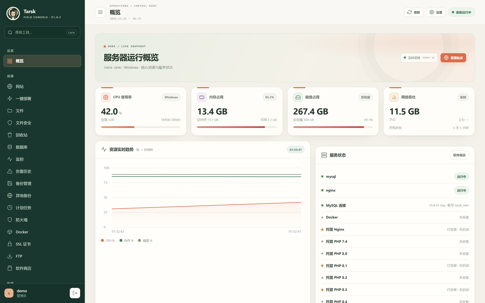
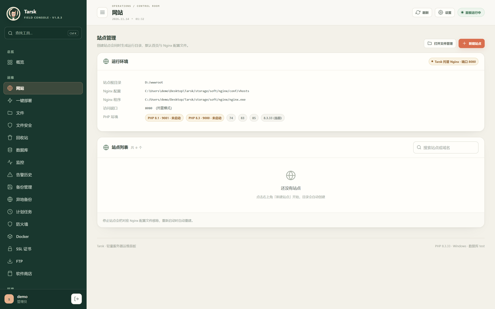
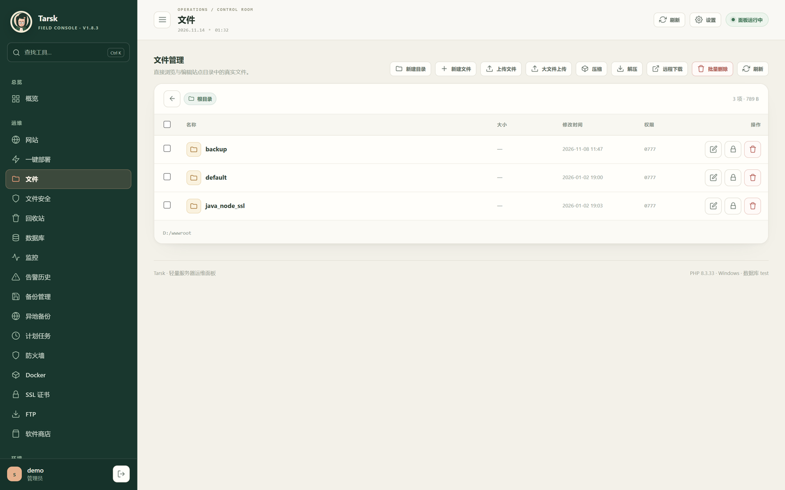
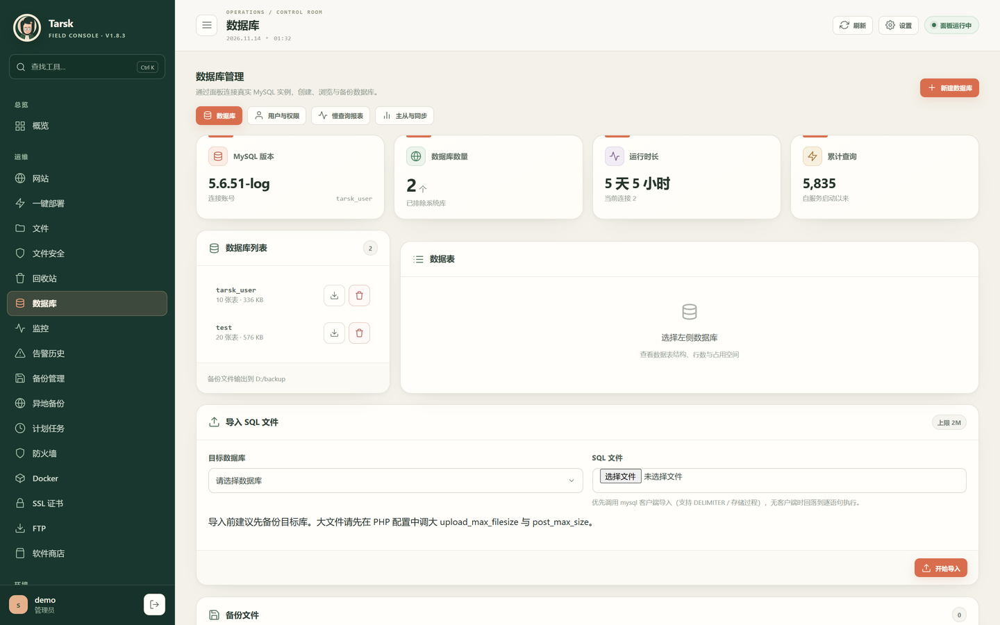
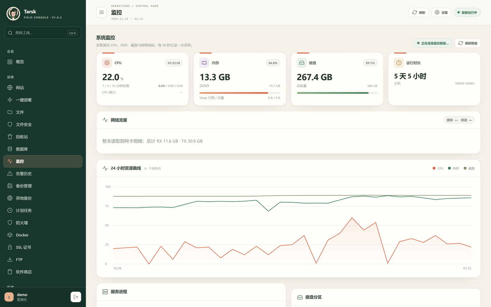
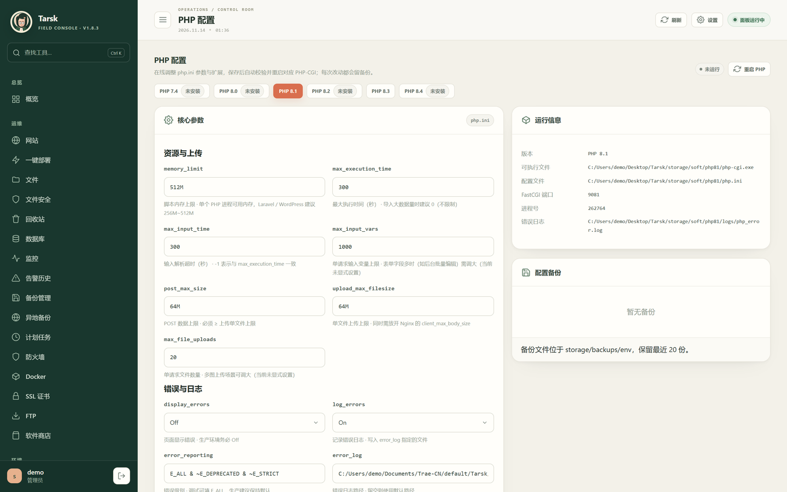
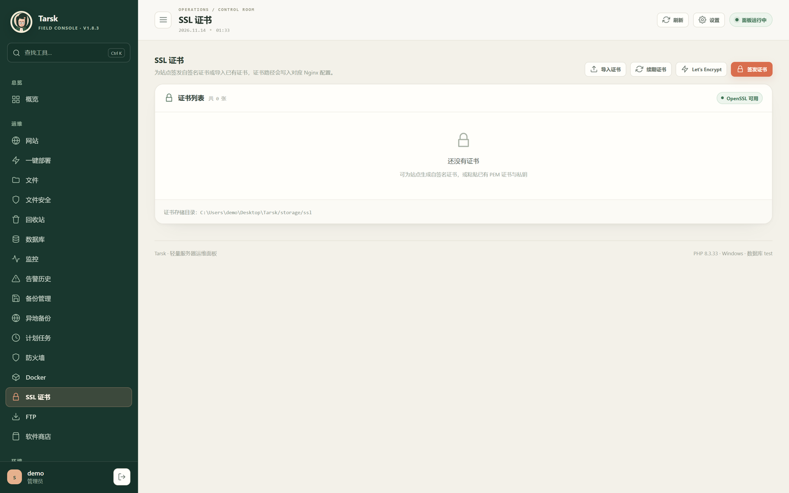

# Tarsk

**开源服务器运维面板 · PHP + MySQL · 零框架零依赖**

Tarsk 是一个用原生 PHP 8 和 MySQL 写成的一体化服务器管理面板：站点、运行环境、文件、数据库、备份、SSL、计划任务、监控告警、安全防护全部在一个界面里完成。后端不依赖 Composer 与任何框架，Windows / Linux 双平台可直接跑，另附原生桌面客户端。



[](LICENSE)
[](https://www.php.net/)
[](https://www.mysql.com/)
[](#环境要求)

---

## 界面预览

| 网站管理 | 文件管理 |
| --- | --- |
|  |  |
| **数据库** | **监控** |
|  |  |
| **PHP 环境配置** | **SSL 证书** |
|  |  |

## 为什么是 Tarsk

- **真机改造，不是模拟**：下载、解压、写配置、起停进程、改防火墙、签发证书，全部操作本机真实服务。
- **绿色安装**：托管环境装进 `storage/soft`，不污染系统目录，卸载即清理。
- **零外部依赖**：无 Composer、无 PDO 之外的扩展强依赖；SMTP、S3/OSS 签名、ACME、TOTP、FTP 服务器均为纯 PHP 实现。
- **双平台一致体验**：Windows 与服务端 Linux 功能对齐，附 Windows 桌面客户端。

## 功能一览

### 站点与运行环境

| 能力 | 说明 |
|---|---|
| 站点管理 | 建站、运行目录、默认文档、伪静态（WordPress / Laravel / ThinkPHP / Discuz / DedeCMS）、一键建库 |
| 多域名与高级项 | 附加域名、强制 HTTPS、防盗链、`open_basedir` 防跨站、上传大小、防 CC 限流 |
| 流量统计与配额 | 按站点从 Nginx 日志增量累计日/月流量，站点列表直接显示；可设月配额（MB），超限每月告警一次 |
| HTTPS 增强 | HTTP/2、HSTS、Let's Encrypt 自动签发与到期续期（ACME v2 纯 PHP）、自签 / 导入证书 |
| 反向代理 | 站点反代到本地服务，自动附带 Host / X-Forwarded-* 头 |
| 自定义配置 | 站点级 Nginx 片段，保存前 `nginx -t` 校验，失败自动回滚 |
| 托管环境 | Nginx / PHP-CGI / Redis 在线安装、启停、卸载，独立端口不与系统服务冲突 |
| 多版本 PHP | 7.4 / 8.0 / 8.1 / 8.2 / 8.3 / 8.4 并行，站点级切换 |
| 环境调参 | php.ini 22 项可视化参数、扩展启停、Nginx 全局配置、MySQL 变量、Redis 键管理，改动必校验 |

### 文件与数据

| 能力 | 说明 |
|---|---|
| 文件管理 | 在线编辑、上传下载、重命名、压缩解压（zip/tar）、chmod、批量删除、URL 远程下载 |
| 大文件上传 | 2 MB 分片、断点续传、合并校验，避免超时与内存占用 |
| 回收站 | 删除先进回收站，可还原 / 彻底删除 / 按时间批量清理 |
| 备份中心 | 站点打包、数据库导出、一键恢复、按目标保留最近 N 份；可选 AES-256-GCM 加密（PBKDF2 派生，流式分块，恢复时输口令解密） |
| 异地备份 | 推送至 S3（SigV4）/ 阿里云 OSS（HMAC-SHA1）/ WebDAV，本地计算签名 |
| 数据库 | 库表浏览、建库删库、SQL 导入、用户与授权、远程访问开关、慢查询报表、主从状态 |
| 文件安全 | sha256 基线篡改检测 + Webshell 特征扫描 |

### 运维与可观测

| 能力 | 说明 |
|---|---|
| 监控 | CPU / 内存 / 磁盘 / 网卡真实采样，30 秒入库；支持 1 小时 / 24 小时 / 7 天 / 30 天四档趋势（原始采样保留 72 小时，小时均值降采样保留 180 天），附今日与昨日均值对比 |
| 告警 | 资源阈值告警 + 站点 HTTP 存活巡检，支持邮件 / 飞书 / 钉钉 / Webhook，带冷却与历史趋势 |
| 告警自愈 | 巡检失败时自动「重建 vhost → 重启 PHP-CGI → 重启 Nginx」并重新探活；修好只记日志不发通知，失败才告警。带每站冷却与每小时上限 |
| 日志分析 | PV/UV、状态码、Top URL / IP / 来源、错误请求、蜘蛛识别、按小时趋势；附实时追踪（3 秒增量拉取，自动滚动） |
| 计划任务 | 固定频率 + 5 段式 cron 表达式，内置备份 / 切日志 / 续证书 / 巡检模板，保留执行历史 |
| 一键部署 | WordPress / Typecho / Discuz! X / Nextcloud，自动建库与写配置 |
| 应用托管 | Node.js / Python / Java 项目托管，探活、日志、开机自启 |
| Git 部署 | 仓库绑定、手动拉取、Webhook 自动部署（签名校验） |
| 系统工具 | 时区、磁盘、swap、SSH 状态、常用系统优化 |
| 终端与进程 | Web 终端、进程列表与结束、防火墙、Docker 管理、FTP 服务 |

### 安全与多人协作

- 安全入口路径、TOTP 两步验证（含 10 个一次性恢复码）、面板 IP 白名单（精确 / 通配 / CIDR）、登录失败自动封禁
- CSRF 防护、会话固定防护、操作日志审计与 CSV 导出
- 三级角色（`admin` / `operator` / `viewer`），按「方法 + 路径」在路由层统一鉴权
- 站点级权限：可把 `operator` / `viewer` 限定到指定站点，列表、详情、写操作、站点 API 与备份下载全部按授权范围收窄
- REST API `/api/v1` + Bearer Token（`read` / `write` scope，只存 SHA-256 摘要），Token 继承签发账号的站点范围
- 明暗主题：浅色 / 深色 / 跟随系统三种默认外观，顶栏太阳按钮即时切换（仅作用于当前浏览器，首屏前生效不闪白）

## 环境要求

- PHP **8.1+**，需 `pdo_mysql`、`openssl`、`mbstring`，建议开启 `proc_open`
- MySQL **5.6+**（面板数据表统一使用 `tarsk_` 前缀）
- Windows 10/11 或主流 Linux 发行版
- 可选：Nginx、MySQL 客户端、Docker、winget

## 快速开始

### 云端一键安装（推荐）

**Linux**

```bash
curl -fsSL https://raw.githubusercontent.com/JackHanXyz/Tarsk/main/install-online.sh \
  | sudo bash -s -- --admin-pass 'YourPassword' --db-user root --db-pass 'dbpass'
```

**Windows**（PowerShell 5.1+）

```powershell
irm https://raw.githubusercontent.com/JackHanXyz/Tarsk/main/install-online.ps1 -OutFile "$env:TEMP\tarsk-install.ps1"
& "$env:TEMP\tarsk-install.ps1" -Dir 'C:\Tarsk' -DbUser root -DbPass 'dbpass' -AdminPass 'YourPassword'
```

安装器只**检测**依赖不修改系统，缺失时会给出安装命令后退出。

| 参数 | 说明 |
|---|---|
| `--dir` / `-Dir` | 安装目录，Linux 默认 `/opt/tarsk`，Windows 默认 `C:\Tarsk` |
| `--upgrade` / `-Upgrade` | 升级模式：保留 `config.php`、`install.lock` 与 `storage` |
| `--local-zip` / `-LocalZip` | 使用离线源码包（内网 / 无外网环境） |
| `--branch` / `-Branch` | 拉取分支，默认 `main` |
| `--proxy` / `-Proxy` | 下载走代理，如 `http://127.0.0.1:10808` |

升级只需加 `--upgrade` / `-Upgrade`；也可以在面板「版本更新」页检查并一键更新（自动备份旧代码）。

### 本地脚本安装

```powershell
# Windows（项目根目录）
.\install.ps1 -DbUser root -DbPass "你的MySQL密码" -AdminPass "至少8位密码"
```

```bash
# Linux（项目根目录）
sudo ./install.sh --db-user root --db-pass "密码" --admin-pass "你的密码" --port 8888
```

Windows 脚本会注册 `Tarsk_Panel` 登录自启任务；Linux 会写入 systemd 服务。默认端口 `8888`，若已被占用会自动改用 `8890-8920` 中的空闲端口并打印实际地址。

### 网页安装向导 / 手动初始化

```bash
php -S 127.0.0.1:8888 -t public public/router.php
# 浏览器打开 http://127.0.0.1:8888/install 按向导填写
```

```bash
cp config.example.php config.php   # 填写数据库连接
php bin/configure.php --host=127.0.0.1 --name=tarsk --user=root --pass=secret \
  --admin=admin --admin-pass=YourPassword --panel-port=8888
php -S 127.0.0.1:8888 -t public public/router.php
```

> 生产环境请把面板置于 HTTPS 反向代理之后，不要将 PHP 内置服务器直接暴露到公网。

## 首次使用

1. 登录面板 →「软件商店」安装 Nginx 与 PHP（可选 Redis）并启动
2. 「网站」新建站点，绑定域名、选伪静态，可同时建库
3. 托管 Nginx 通过 `http://服务器:8080` + `Host` 头访问站点，端口可在设置中修改
4. 「SSL 证书」签发或导入证书，站点自动启用 HTTPS
5. 「监控」「计划任务」「告警」「日志分析」完成日常运维

## 桌面客户端

`desktop/tarsk_panel_v2.py` 是独立的 Windows 桌面客户端（Tkinter，单文件 EXE），通过 `/api/v1` 连接面板，提供总览、站点、数据库、备份、任务、告警、Nginx 七个视图，Token 由 Windows DPAPI 加密保存。

```bash
python desktop/build_exe.py   # 产物：desktop/dist/TarskControlCenter.exe
```

## REST API

所有接口位于 `/api/v1`，使用 Bearer Token 认证：

```bash
curl -H "Authorization: Bearer <token>" http://127.0.0.1:8888/api/v1/status
```

可用端点：`status`、`sites`、`databases`、`backups`、`tasks`、`alerts`、`nginx`。Token 在面板「API」页创建，只显示一次。

## 目录结构

```
Tarsk/
├── app/
│   ├── bootstrap.php     配置、会话、鉴权、模板、日志、自动迁移
│   ├── db.php            PDO、表结构、增量迁移、种子数据
│   ├── system.php        系统指标 / 服务 / 软件 / 防火墙 / Docker
│   ├── runtime.php       托管环境下载安装与进程管理
│   ├── envconfig.php     php.ini / 扩展 / Nginx / MySQL / Redis 在线配置
│   ├── site_vhost.php    站点 vhost 生成与伪静态
│   ├── backup.php        备份、恢复与保留策略
│   ├── remote.php        S3 / OSS / WebDAV 异地备份
│   ├── dbadmin.php       数据库用户、导入、慢查询、复制
│   ├── loganalytics.php  访问日志解析与聚合
│   ├── filesecurity.php  完整性基线与 Webshell 扫描
│   ├── tasks.php         计划任务执行器
│   ├── acme.php          Let's Encrypt ACME v2 客户端
│   ├── notify.php        SMTP / Webhook 通知与告警
│   ├── security.php      登录封禁、IP 白名单
│   ├── authz.php         角色与权限矩阵
│   ├── siteaccess.php    站点级授权范围（user_sites）
│   ├── api.php           REST API 分发
│   ├── updater.php       在线升级
│   ├── ftpd.php          纯 PHP FTP 服务器
│   ├── totp.php          RFC 6238 两步验证
│   ├── projects.php      Node / Python / Java 托管
│   ├── gitdeploy.php     Git 部署与 Webhook
│   ├── controllers/      控制器
│   └── views/            模板与布局
├── bin/                  命令行入口（配置、初始化、任务、FTP、重置密码）
├── public/               入口、安装向导、静态资源
├── desktop/              Windows 桌面客户端
├── storage/              缓存、日志、证书、回收站、托管软件（运行时生成，已忽略）
├── install.sh            Linux 一键安装
├── install.ps1           Windows 一键安装
├── install-online.*      云端安装 / 升级
└── config.php            配置（安装时生成，已忽略）
```

## 说明与限制

- **数据库权限**：默认账号若无 `CREATE DATABASE` 权限，只能浏览已有库；在「面板设置」填入 root 账号可解锁完整管理。
- **托管环境**：完整的下载安装能力以 Windows 为主（官方 ZIP + php-cgi + Redis for Windows）；Linux 下面板会探测并管理系统已有服务。
- **配置隔离**：托管 Nginx 的站点配置写入 `storage/soft/nginx/conf/vhosts`，独立端口运行，不影响系统 Nginx。
- **执行权限**：防火墙、结束进程、终端命令等依赖运行账号权限，失败原因会显示在界面并写入日志。
- **不要禁用 `proc_open`**：面板依赖它执行命令。

## 安全建议

1. 生产环境保持 `config.php` 中 `app.debug = false`。
2. 配置安全入口、开启两步验证，面板仅在 HTTPS 反向代理后暴露。
3. 为面板设置强密码，定期检查「操作日志」。
4. 终端与软件安装拥有系统权限，仅在可信环境使用。
5. 启用面板 SSL 后建议替换 `storage/ssl/panel/` 下的自签证书。

## 贡献

欢迎提交 Issue 与 Pull Request。改动前请先开 Issue 描述场景；提交前至少保证：

```bash
php -l <改动文件>        # 语法检查
```

## License

[MIT](LICENSE)
